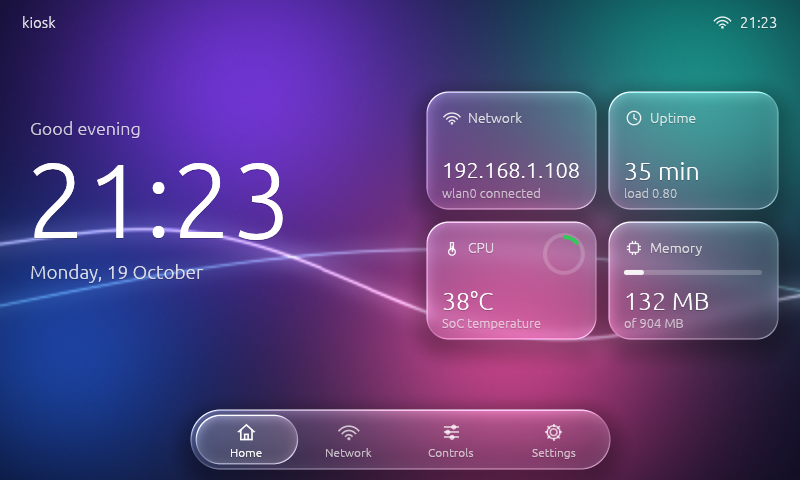
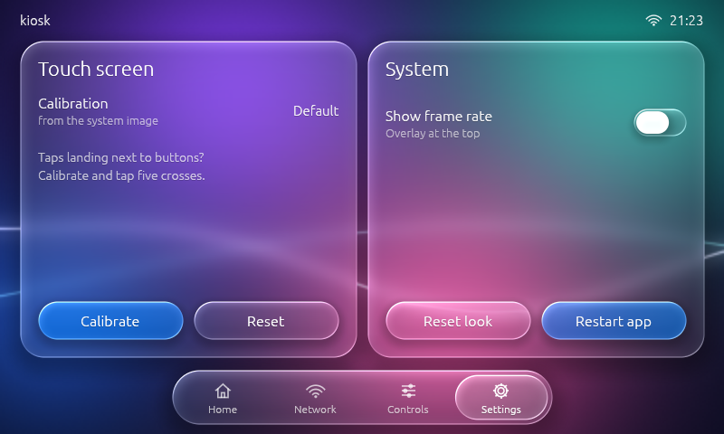
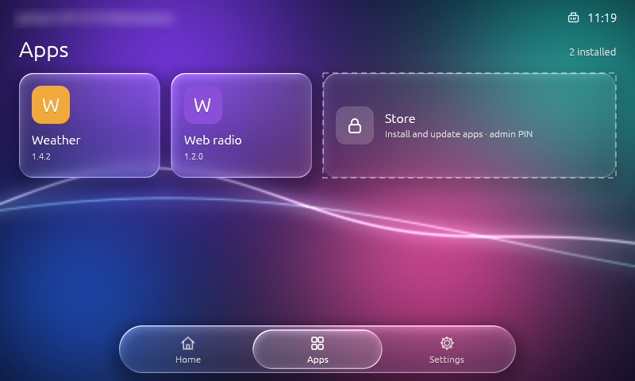
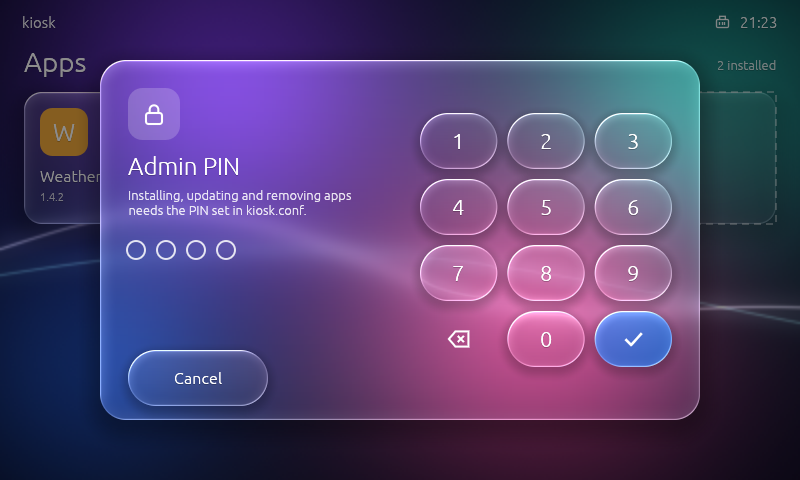
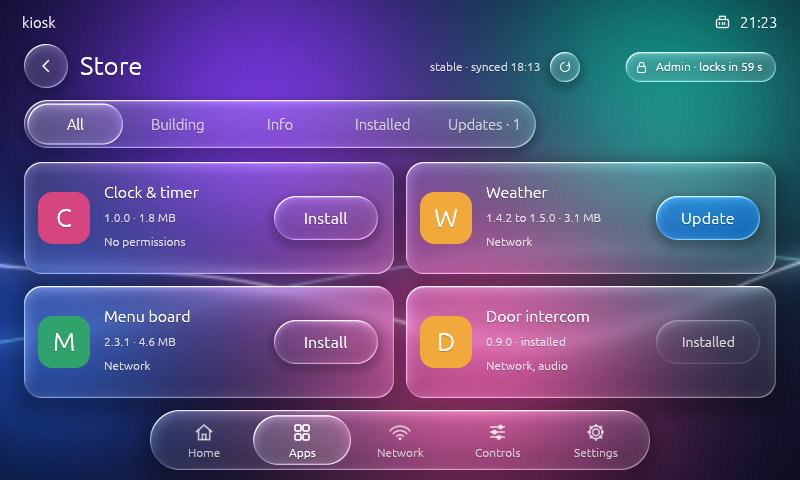
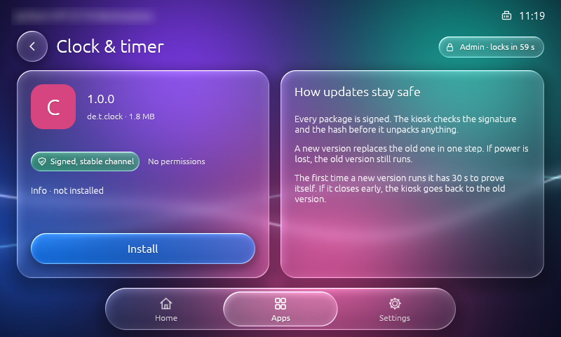
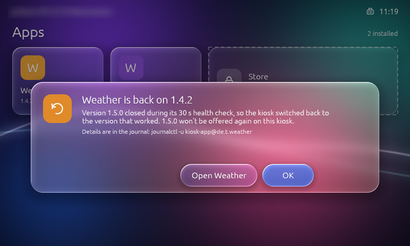

<p align="center">
  <picture>
    <source media="(prefers-color-scheme: dark)" srcset="media/logo-dark.svg">
    
  </picture>
</p>

# pikiosk: Raspberry Pi kiosk OS with a Rust touchscreen UI

[](https://github.com/pierrejochem/pikiosk/releases/latest)
[](https://github.com/pierrejochem/pikiosk/actions/workflows/ci.yml)
[](LICENSE)

**Website: [pierrejochem.github.io/pikiosk](https://pierrejochem.github.io/pikiosk/)**

A minimal, read-only kiosk OS for the **Raspberry Pi 3B, 4 and 5 (64-bit)**, built with Buildroot 2026.08.
It boots straight into one fullscreen native application. There is no login prompt on the screen,
on the serial port or anywhere else, and no desktop.

Use it for touchscreen kiosks, digital signage, info displays and control panels. The included app,
**kiosk-ui**, is written in Rust with egui and draws a liquid-glass interface directly through
DRM/KMS and OpenGL ES 2, without X11 or Wayland. It includes on-device touchscreen calibration.



| | |
|---|---|
| Kernel | Raspberry Pi kernel 6.12 (arm64), KMS graphics |
| Init | systemd, read-only root filesystem, logs in RAM |
| Boards | Raspberry Pi 3B, Pi 4 and Pi 5, one image per board |
| Display | Waveshare 5inch HDMI LCD (B): 800×480, USB touch |
| Graphics | DRM/KMS + Mesa (VC4 on the Pi 3B, VC4 + V3D on the Pi 4 and 5): EGL, GLES2, GBM, no X11/Wayland |
| App | `kiosk-ui`: Rust + egui with liquid-glass widgets, touch via libinput |
| Apps | installable packages (`.kpkg`) from a signed store or from the SD card, one on screen at a time |
| Network | Ethernet + onboard WiFi (DHCP or static), DNS, NTP, mDNS (`kiosk.local`) |
| Maintenance | SSH with public keys only, off unless you provide a key |
| Robustness | hardware watchdog, app auto-restart, reboot on crash loop, kernel panic auto-reboot |

## Download

Get a ready-to-flash SD card image from the
[latest release](https://github.com/pierrejochem/pikiosk/releases/latest):
`pikiosk-<version>-<board>-sdcard.img.xz`, with `<board>` one of `rpi3`, `rpi4` or `rpi5`.
Raspberry Pi Imager flashes it directly ("Use custom").
Then edit `kiosk.conf` on the `KIOSKBOOT` partition, as described under
[Configure](#configure-no-rebuild-needed).

## Build (macOS or Linux)

Requires Docker. On Apple Silicon it builds natively (Buildroot compiles its own cross toolchain).

```sh
./build.sh                 # first build ~1-1.5 h, later builds use ccache
# -> out/sdcard.img
```

Flash `out/sdcard.img` with Raspberry Pi Imager ("Use custom") or `dd`.

`BOARD=rpi4 ./build.sh` or `BOARD=rpi5 ./build.sh` build the other boards into `out/sdcard-<board>.img`.

Other commands: `./build.sh app`, `./build.sh menuconfig`, `./build.sh savedefconfig`, `./build.sh shell`, `./build.sh clean`.

Repeat builds are incremental: the build volume keeps the toolchain, kernel and Mesa, a second volume (`pikiosk-ccache`) keeps compiler output across `clean`, and every `./build.sh` rebuilds `kiosk-ui` and `kioskd` from the current source (about a minute when nothing else changed).

Without Docker on a Linux machine:

```sh
git clone -b 2026.08 https://gitlab.com/buildroot.org/buildroot.git
cd buildroot
make BR2_EXTERNAL=/path/to/pikiosk pikiosk_rpi3_defconfig   # or pikiosk_rpi4_defconfig, pikiosk_rpi5_defconfig
make
# -> output/images/sdcard.img
```

## Display: Waveshare 5inch HDMI LCD (B)

On the Pi 4 and Pi 5 the panel needs a micro-HDMI adapter cable; the connector is still `HDMI-A-1`.

The panel has no usable EDID, so `config.txt` forces the HDMI output on with an 800×480 CVT mode
and `cmdline.txt` sets `video=HDMI-A-1:800x480@60e`. Touch is USB HID (built into the kernel).

- At 800×480 kiosk-ui switches to a layout drawn for that size, with larger type and touch targets.
- This panel has no software backlight, so the Controls page shows no Brightness slider. On a
  panel with `/sys/class/backlight` (e.g. a DSI panel) it appears automatically.
- kiosk-ui would prefer a DSI panel over HDMI if both were connected; `UI_OUTPUT=hdmi` in
  `kiosk.conf` reverses that.
- The touch layer is resistive and single-touch. kiosk-ui accepts a tap that wobbles up to 20 px,
  because a fingertip moves that much while pressed.
- The image ships a touch calibration for this panel
  (`board/common/rootfs-overlay/etc/udev/rules.d/99-touch-calibration.rules`). To recalibrate on the
  device, open **Settings → Calibrate** and tap the five crosses.

## Configure (no rebuild needed)

After flashing, the SD card's FAT partition `KIOSKBOOT` shows up on your Mac. Edit **`kiosk.conf`**
there: hostname, timezone, WiFi SSID/password, static IP, NTP servers and which app to run.
Changes apply on the next boot.

For SSH access, put your public key into a file named **`authorized_keys`** on the same partition
(see `authorized_keys.example`), then `ssh root@kiosk.local`. Without that file SSH does not run.

## The kiosk app: kiosk-ui (Rust + egui, liquid glass)



`kiosk-ui/` is the app that starts at boot: a Rust program using **egui** with **liquid-glass**
panels and controls. Glass elements refract, frost and light the wallpaper behind them with a
custom GLES 2 shader. It draws straight to the display through DRM/KMS + GBM + EGL (no X11 or
Wayland), and reads touch, mouse and keyboard through libinput.

The layout adapts: a compact design for 800×480 panels, a roomier one from 1280×720 up
(`docs/kiosk-ui-1280x720.png`). Five pages, switched with the floating tab bar, a horizontal swipe or the arrow keys:
- **Home**: clock, date, network address, uptime, CPU temperature and memory
- **Apps**: the installed apps as tiles, and the Store (see [Apps and the app store](#apps-and-the-app-store))
- **Network**: interfaces with addresses and state, WiFi signal, gateway, DNS
- **Controls**: frost and refraction sliders, wallpaper themes, brightness (on panels with a
  backlight), animated-wallpaper toggle
- **Settings** (`docs/kiosk-ui-settings.png`): touch calibration, frame-rate overlay, reset the look,
  restart the app

**Touch calibration:** **Calibrate** shows five crosses, one after another. Tap the centre of each.
kiosk-ui fits a libinput calibration matrix to the taps, then shows a check screen where dots mark
where your touches land. **Keep** saves it. Without Keep, the previous calibration comes back after
15 s, so a bad calibration can't lock you out. **Reset** returns to the image's default.

Settings are saved to `/data/app/kiosk-ui.conf`. A touch calibration saved there survives
re-flashing the root filesystem.

**Run it on your Mac** while developing (opens a 1280×720 window):

```sh
cd kiosk-ui
cargo run --release --features desktop
```

**Screenshots without a display** (Linux with Mesa, including on the Pi over SSH):

```sh
kiosk-ui --screenshot shot.png --size 800x480 --page all
```

`cargo test` drives the real UI with simulated touches (tab bar, toggle, slider, segmented
control, swipe, brightness, a full touch calibration) at 1280×720 and 800×480 in an offscreen GL
context.

Display settings live in `kiosk.conf` (`UI_FPS`, `UI_SCALE`, `UI_MODE`, `UI_OUTPUT`). Copy a photo named
`wallpaper.jpg` onto the boot partition and pick "Photo" on the Controls page to put the glass
over your own image.

On the Pi 3B the animated wallpaper costs GPU time. The frame rate is capped at 30 fps by default.
With animation off, the screen redraws once a second for the clock and on touch.

Source layout:

```
kiosk-kit/src/glass.rs     glass renderer: wallpaper, blur chain, glass shader as egui paint callbacks
kiosk-kit/src/shaders/     GLSL ES 1.00 shaders (re-prefixed for desktop GL on the Mac)
kiosk-kit/src/widgets.rs   glass button, toggle, slider, segmented control, tab bar, icons
kiosk-kit/src/calibrate.rs touch calibration: affine fit and the calibration screen
kiosk-kit/src/kms.rs       DRM/KMS + GBM + EGL + libinput backend (prefers the DSI panel)
kiosk-kit/src/lib.rs       the `App` trait and `run`: what an app needs to draw on the display
kiosk-ui/src/app.rs        the four pages and settings
kiosk-ui/src/backlight.rs  display brightness via /sys/class/backlight
kiosk-ui/src/headless.rs   offscreen rendering, screenshots, UI test
kiosk-ui/src/desktop.rs    eframe window for development
```

## Apps and the app store



Apps are packages (`.kpkg`) built on [`kiosk-kit`](kiosk-kit/), the crate kiosk-ui itself uses for the
display, touch and the glass look. **One app owns the screen at a time**: tapping a tile stops kiosk-ui
and starts the app, and kiosk-ui comes back when the app ends. **Hold the top-right corner of the
screen for 3 seconds** to leave an app, even a hung one. The design and what was built in each phase
are in [docs/app-store.md](docs/app-store.md).

| Where apps come from | How |
|---|---|
| The signed store | set `STORE_URL` in `kiosk.conf`. The store is a [TUF](https://theupdateframework.io) repository ([pikiosk-apps](https://github.com/pierrejochem/pikiosk-apps) is the publisher): every package is checked for signature, expiry, rollback and hash before it is unpacked. The board checks it only after NTP has set the clock |
| The SD card | development only: put `.kpkg` files in an `apps` folder on `KIOSKBOOT` and set `STORE_ALLOW_UNSIGNED=yes` |

Both are **off by default**: with an empty `STORE_URL` and no `STORE_PIN`, the Store tile is hidden
and nobody can install anything. Installed apps never need the network.



**Admin PIN.** Installing, updating and removing apps needs the PIN from `STORE_PIN` in `kiosk.conf`
(4 to 8 digits). The Store tile asks for it on a glass keypad. kioskd checks the PIN; kiosk-ui only
holds a token that ends 60 s after the last touch. After 3 wrong PINs every PIN is refused for
`STORE_PIN_LOCKOUT` seconds (default 300), and pulling the power does not reset that. Anyone who can
read the SD card can read the PIN in `kiosk.conf`.



**Installs and updates** replace the old version in one atomic step, so pulling the power mid-install
leaves the previous version running. The app's own data in `/data/store/data/<id>` survives updates
and re-flashing.



**Health gate and rollback.** The first time a new version runs it has 30 s to stay up. If it crashes
instead, the kiosk switches back to the previous version, deletes and blocks the bad one, and shows a
notice.



### Store settings in `kiosk.conf`

| Key | Default | Meaning |
|---|---|---|
| `STORE_URL` | empty (store off) | base URL of the store, e.g. `https://example.github.io/pikiosk-apps`; the board reads `<url>/<channel>/metadata` and `/targets` |
| `STORE_CHANNEL` | `stable` | `stable` or `beta` |
| `STORE_PIN` | empty (nobody is admin) | 4 to 8 digits |
| `STORE_PIN_LOCKOUT` | `300` | seconds every PIN is refused after 3 wrong ones |
| `STORE_ALLOW_UNSIGNED` | `no` | install unsigned `.kpkg` files from `/boot/apps` (development) |
| `KIOSK_HOME_GESTURE` | `yes` | the 3 s top-right hold that leaves an app |

### Publishing an app

An app is a Rust crate that implements `kiosk_kit::App` and calls `kiosk_kit::run`, plus a
`manifest.toml` and a 128×128 icon. Start from `apps/hello` in
[pikiosk-apps](https://github.com/pierrejochem/pikiosk-apps), which also holds the key ceremony, the
publish workflow and the instructions. Each release attaches an SDK (`pikiosk-<version>-sdk-aarch64.tar.gz`)
whose sysroot the workflow links against, so one binary runs on all three boards.

```sh
cargo run --release -p kpkg -- build my-app/ -o my-app.kpkg   # lints manifest.toml, icon and entry
cargo run --release -p kpkg -- inspect my-app.kpkg
```

> The trust anchor in this repository (`package/kioskd/root.json`) lists the public halves of the store's four signing keys. Devices trust exactly this file, so changing it means a new image. The private keys are not in any repository.

## Running a different app

**Deploy to /data (fastest to iterate).** `/data` is a writable partition that grows to fill the card
on first boot. Copy an aarch64 binary there and point `kiosk.conf` at it:

```sh
scp myapp root@kiosk.local:/data/app/myapp
# kiosk.conf:  APP=/data/app/myapp
ssh root@kiosk.local systemctl restart kiosk
```

To try a changed kiosk-ui on the Pi without re-flashing:

```sh
./build.sh app                                   # rebuilds only kiosk-ui -> out/kiosk-ui
scp out/kiosk-ui root@kiosk.local:/data/app/
# kiosk.conf:  APP=/data/app/kiosk-ui
```

**Bake it into the image.** Add a Buildroot package under `package/` (`package/kiosk-ui` is a Rust
example) and enable it in `configs/pikiosk_rpi3_defconfig`.

The runtime libraries your app needs must be in the image. Ready-made fragments:

```sh
./build.sh with qt6       # Qt 6 Widgets + Quick on EGLFS
./build.sh with sdl2      # SDL2 on KMSDRM (+ TTF, image)
./build.sh with flutter   # flutter-pi
```

Then set the matching environment in `kiosk.conf`, e.g. `APP_ENV=QT_QPA_PLATFORM=eglfs QT_QPA_EGLFS_HIDECURSOR=1`.
To cross-compile outside Buildroot, use the SDK: `./build.sh shell`, then `make O=/work/output sdk`.

How the app runs:
- as the unprivileged `kiosk` account (groups video, render, input, audio), never as root
- working directory and `$HOME` = `/data/app` (persistent, the only place it can write)
- restarted 2 s after it exits; 5 crashes within 2 minutes reboots the board

## Layout

```
SD card
├── p1  KIOSKBOOT  FAT32  64 MB   firmware, kernel, kiosk.conf, authorized_keys   (mounted ro on /boot)
├── p2  kioskroot  ext4   256 MB  the OS                                          (mounted ro on /)
└── p3  kioskdata  ext4   rest    SSH host keys, /data/app                         (mounted rw on /data)
```

Pulling the power is safe: the OS partitions are never written. Everything generated at boot
(WiFi config, network files, timezone) goes to `/run`, see `board/common/rootfs-overlay/usr/libexec/kiosk/apply-config`.

## Repository

```
configs/pikiosk_<board>_defconfig  Buildroot configuration per board
configs/fragments/                 optional Qt6 / SDL2 / Flutter add-ons
board/rpi3,rpi4,rpi5/              config.txt and cmdline.txt: firmware and kernel command line
board/common/genimage.cfg.in       SD card layout
board/common/post-build.sh         disables all logins, wires ro rootfs to /run and /data
board/common/rootfs-overlay/       systemd units, network files, config scripts
board/common/boot/                 files placed on the FAT partition
board/common/linux.fragment        kernel options shared by all boards
Cargo.toml                         Cargo workspace
kiosk-kit/                         display, touch and glass widgets as a library (what apps build on)
kiosk-ui/                          the kiosk app (Rust, egui, liquid glass), with the Apps page
kioskd/                            root daemon: launches apps, Home gesture, installs, PIN, health gate
kpkg/                              .kpkg format and tool: build, inspect, verify, catalog
package/kiosk-ui, package/kioskd/  Buildroot packages (kioskd carries the trust anchor root.json)
CHANGELOG.md                       what changed in each release
build.sh, docker/                  containerised build
```

## Notes

- The serial console on GPIO 14/15 (115200 baud) prints kernel messages only; there is no shell on it.
- The board has no RTC (the Pi 5 has one, with an optional battery), so the clock is correct only after NTP sync. The store checks for updates only after that.
- The Pi 4 and Pi 5 images are built by CI and have not been run on hardware yet; both need a micro-HDMI adapter for the Waveshare panel. The Pi 3B is the tested board.
- WPA3-only networks will not work: the Pi 3B's WiFi chip does not support SAE. WPA2 and WPA2/WPA3 mixed mode work.
- Debugging over SSH: `journalctl -u kiosk -f`, `networkctl`, `wpa_cli -i wlan0 status`.
- The kiosk-ui build downloads its Rust crates during `./build.sh` (versions pinned by `Cargo.lock`),
  so that step needs network access.
- Glass refracts the wallpaper, not other UI elements underneath it (egui has no backdrop capture).

## License

MIT, see [LICENSE](LICENSE). Buildroot, the Linux kernel and the other packages in the image keep
their own licenses.
